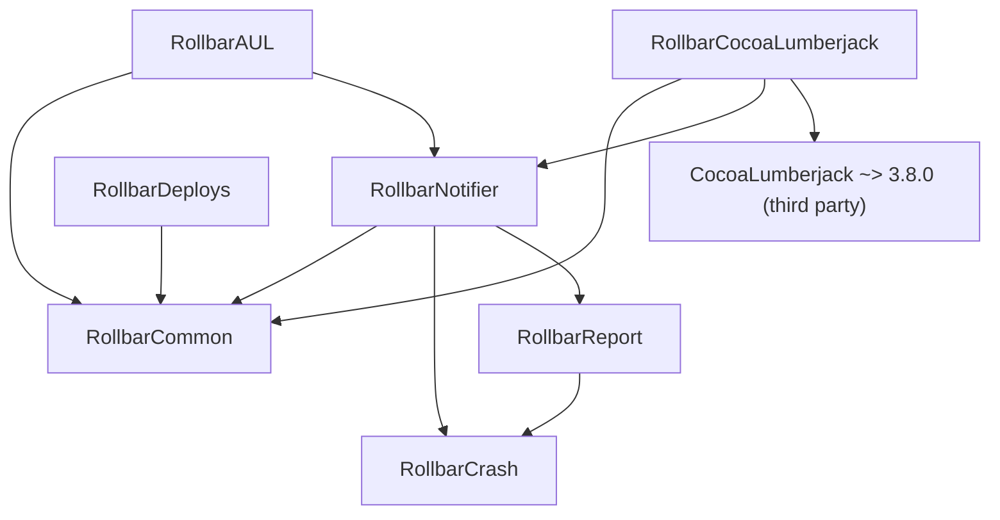

# Releasing to CocoaPods

The SDK goes to CocoaPods as seven pods. Some pods depend on others, so the
order of the pushes matters.

CocoaPods trunk stops taking new versions for good on December 2, 2026, after
a test freeze from November 1 to 7. After that, SwiftPM is the only way to
ship.

## Before you start

- Every podspec has the same version.
- The git tag for that version is on GitHub. Each podspec downloads the source
  at that tag (`:tag => s.version.to_s`).

## Why a pod has to wait

Each pod needs the same version of the pods it depends on
(`s.dependency "RollbarCommon", "~> #{s.version}"`). `pod trunk push` checks
the pod against the versions trunk's CDN serves. So a pod can go out only after
the CDN serves the new version of every pod it needs. That takes about 20
minutes after each push.

## Which pod needs which

An arrow points from a pod to a pod it needs.



| Pod | Needs | Platforms |
|---|---|---|
| RollbarCommon | nothing | iOS, macOS, tvOS, watchOS |
| RollbarCrash | nothing | iOS, macOS, tvOS, watchOS |
| RollbarReport | RollbarCrash | iOS, macOS, tvOS, watchOS |
| RollbarDeploys | RollbarCommon | iOS, macOS, tvOS |
| RollbarNotifier | RollbarCommon, RollbarCrash, RollbarReport | iOS, macOS, tvOS, watchOS |
| RollbarAUL | RollbarCommon, RollbarNotifier | macOS |
| RollbarCocoaLumberjack | RollbarCommon, RollbarNotifier, CocoaLumberjack | iOS, macOS, tvOS, watchOS |

`Package.swift` has the same dependencies between its targets.

## Push order

Push in four rounds. Push the pods of one round together. Start the next round
only when the CDN serves every pod of the round before it.

1. RollbarCommon, RollbarCrash
2. RollbarReport, RollbarDeploys
3. RollbarNotifier
4. RollbarAUL, RollbarCocoaLumberjack

That is three waits, not six. RollbarDeploys needs only RollbarCommon, so it can
also go in round 3 or 4.

To see if the CDN serves a version, run this (macOS `md5`; on Linux use
`md5sum | cut -c1-32`):

```bash
p=RollbarCrash; v=3.4.1; h=$(printf %s "$p" | md5 -q); curl -s "https://cdn.cocoapods.org/all_pods_versions_${h:0:1}_${h:1:1}_${h:2:1}.txt" | grep "^$p/" | tr / '\n' | grep -qx "$v" && echo ready || echo "not yet"
```

`pod trunk push --synchronous` may remove the wait: it checks against
CocoaPods' git Specs repo, which has a new version right after its push, not
the CDN. Nobody has tried it on this repo yet. The first run clones the whole
Specs repo, which is very large.

## Do not push `Rollbar.podspec`

On trunk, the name `Rollbar` belongs to the old rollbar-ios SDK (1.x). A 3.x
version under that name would reach every app that asks for `Rollbar` with no
version, on its next `pod update`, and break its build. `Rollbar` has never
been published at 3.x.

## Run `podpub.sh`

`podpub.sh` pushes the pods in the rounds above. Before each round but the
first, it waits until the CDN serves the pods that round needs. It never pushes
`Rollbar.podspec`.

You need `pod` and a CocoaPods trunk session. Check out the release tag first.

Lint the pods:

```bash
./podpub.sh --lint
```

`pod spec lint` checks a pod against the versions trunk has. So before round 1
is out, only RollbarCommon and RollbarCrash can pass. The others fail because
trunk does not have the new versions they need yet.

Then push:

```bash
./podpub.sh
```

Before it pushes, it checks that the tag equals `s.version` in every podspec.
It checks that the tag is on GitHub at the same commit as here, and that the
podspecs here are the ones at the tag. Then it shows the plan and asks. It
skips a pod the CDN already serves at the tag. The three waits take about an
hour in all.

If a push fails or a wait times out, the script stops and says which round to
rerun from:

```bash
./podpub.sh --from-round 3
```

A rerun first waits until the CDN serves the pods its first round needs. Then
it skips the pods the CDN already serves. After a failed push, fix the cause.
Also wait until the CDN serves the pods that did go out, about 20 minutes after
their push. Trunk refuses a pod it already has, so a rerun before that fails.

Nothing needs RollbarDeploys. If it cannot go out, `--from-round 3` still
pushes the rest.

`--synchronous` passes `--synchronous` to `pod trunk push` (see above). It may
remove the need to wait, but the script still waits for the CDN before each
round, so a rerun can tell which pods are out.

Run `./podpub.sh --help` for the other options.
